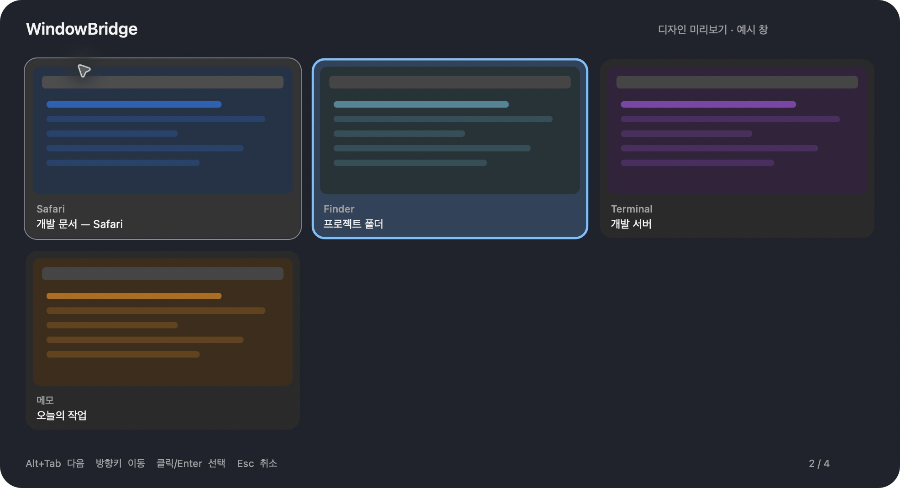

# MacLikeWindowStyle

**Mac을 Windows처럼 사용하는 사람을 위한 메뉴 막대 유틸리티.**

앱 이름은 **WindowBridge**입니다. 왼쪽 Alt+Tab으로 개별 창의 미리보기를 보고 전환하며, 기존 Windows 스타일 키보드·마우스 설정을 한곳에서 관리합니다.



## 기능

- 앱이 아닌 **창 단위 Alt+Tab**: 썸네일, 최근 사용 순서, Alt 해제 시 전환
- 방향키 상하좌우 이동, 클릭/Enter 선택, Esc 취소
- 마우스를 올린 카드 강조와 짧은 페이드. macOS ‘동작 줄이기’ 반영
- 상단 메뉴 막대에서 관리. Dock에 실행 아이콘을 표시하지 않음
- 키보드·마우스·창 전환·백업/복원 탭
- 기존 한영키, Alt+F4, Finder 단축키, Ctrl/탐색키, 휠 설정의 독립 제어
- 변경 전 로컬 백업, 외부 설정 변경 감지, 실패 시 복구 및 재시도

Swift / AppKit / ScreenCaptureKit 기반이며 앱 자체에 외부 라이브러리나 네트워크 통신이 없습니다. 입력 변환은 별도로 설치한 [Karabiner-Elements](https://karabiner-elements.pqrs.org/), 마우스 변환은 [LinearMouse](https://linearmouse.app/)가 담당합니다. 두 프로젝트의 코드는 포함하지 않습니다.

## 빌드와 설치

macOS 14 이상과 Swift 5.9 이상의 macOS 개발 도구가 필요합니다. Xcode 또는 Xcode Command Line Tools를 먼저 설치하세요.

```sh
git clone https://github.com/miumi44/MacLikeWindowStyle.git
cd MacLikeWindowStyle
./scripts/test-windowbridge.sh
./scripts/build-windowbridge.sh
./scripts/install-app.sh
open "$HOME/Applications/WindowBridge.app"
```

설치 스크립트는 `~/Applications`를 사용하며 관리자 권한이 필요하지 않습니다. 기존 앱이 있으면 덮어쓰지 않습니다. 먼저 기존 앱을 종료하고 별도로 보관하세요.

1. 앱의 **창 전환** 탭에서 화면 기록과 손쉬운 사용 권한을 허용합니다.
2. 필요하면 앱을 다시 실행하고 **백그라운드에서 왼쪽 Alt+Tab 사용**을 켭니다.
3. 다른 창 전환 앱이 같은 단축키를 사용하면 끄세요. BetterCmdTab은 실행 중이면 종료 여부를 확인합니다.
4. 설정 창을 닫아도 메뉴 막대에서 계속 동작합니다. 로그인 자동 실행은 추가하지 않습니다.

로컬 ad-hoc 서명 빌드이며 Apple 공증 배포본은 아닙니다. 재빌드 또는 설치 위치 변경 후 macOS가 기존 권한을 다시 요구할 수 있습니다.

## 사용

왼쪽 Alt를 누른 채 Tab으로 선택하고 Alt를 놓으면 해당 창으로 전환합니다. Shift+Tab은 역순, 방향키는 카드 배치대로 이동합니다. Alt를 누른 채 카드를 클릭하면 바로 전환합니다. Esc는 취소합니다.

**키보드·마우스 변경은 ‘변경 적용’을 눌러야 저장됩니다.** Windows 권장값 버튼은 화면의 선택만 바꿉니다. 창 전환과 호버 효과 켜기/끄기는 즉시 반영됩니다.

## 다른 Mac에서 입력 설정 사용하기

창 전환은 독립적으로 사용할 수 있습니다. 통합 입력 설정은 이 프로젝트의 기존 Karabiner 규칙 이름과 기본 LinearMouse 마우스 scheme을 읽는 방식입니다. 앱이 두 프로그램을 설치하거나 처음부터 모든 프로필을 생성하지는 않습니다.

[입력 설정 준비 안내](docs/input-setup.md)와 `examples/`의 일반 예제를 사용하세요. 예제의 키보드 장치 ID는 가상 값입니다. **그대로 개인 설정 파일에 덮어쓰면 안 됩니다.** 자신의 장치로 바꾸고 기존 설정에 병합해야 합니다. 지원하는 기존 규칙을 찾지 못하면 해당 항목은 비활성화됩니다. 고급 키 조합·장치별 규칙은 각 프로그램에서 설정합니다.

## 로컬 데이터와 복구

- 읽기/변경 대상: `~/.config/karabiner/karabiner.json`, `~/.config/linearmouse/linearmouse.json`
- 기존 한영 보완 설정: `~/Library/LaunchAgents/com.codex.hangul-key-remap.plist`와 현재 hidutil 매핑
- 마우스 전역 설정: 자연스러운 방향·관성·휠 배율만 관리
- 백업: `~/Library/Application Support/WindowBridge/Backups`
- 화면 썸네일은 메모리에서만 처리하며 디스크에 저장하거나 전송하지 않음

**백업·복원 → 마지막 적용 되돌리기**를 사용하세요. 다른 앱이 이후 설정을 바꿨으면 덮어쓰지 않고 중단합니다. 한영키 변경은 기존 보완 LaunchAgent가 있어야 하며, 다른 매핑을 보존합니다. 키보드·마우스 설정 파일이 없는 첫 설치에서는 준비 안내를 먼저 따르세요.

제거하려면 메뉴에서 종료하고 앱을 휴지통으로 옮깁니다. 앱을 제거하는 것만으로 이미 적용한 입력 설정이 되돌아가지는 않습니다. 필요한 복원은 제거 전에 진행하세요.

## 현재 한계

개인 환경에서 시작한 초기 프로젝트입니다. 모든 키보드·macOS 앱 조합에서 검증된 완제품은 아닙니다. 창 활성화는 앱별 Accessibility 지원에 따라 실패할 수 있고, 보호된 창·보안 입력·로그인/잠금 화면에서는 동작이 제한됩니다. 비슷한 제목의 창은 위치를 함께 사용해 구분합니다. 최근 사용 순서는 앱 실행 중 관찰한 정보입니다.

## 개발

`Sources/WindowBridge`는 macOS UI·미리보기·전역 단축키를, `Sources/WindowBridgeCore`는 선택 상태와 설정 변경/복구를 담당합니다. 테스트는 임시 폴더와 가짜 명령 실행기를 사용하며 실제 입력 설정을 바꾸지 않습니다. macOS CI에서 회귀 검사와 release 빌드를 실행합니다.

버그 제보 시 재현 단계, macOS 버전, 키보드 종류를 적어 주세요. 토큰·암호·개인 창 화면이나 전체 사용자 설정은 올리지 마세요.

## 라이선스

[MIT](LICENSE). Copyright © 2026 miumi44.

### 창 절반 배치 (실험 기능)

설정 → 창 전환에서 **Command + 왼쪽 Alt + 화살표로 창 절반 배치**를 켭니다. 화살표를 누른 뒤 Command와 Alt를 모두 놓으면 현재 창이 위치한 화면의 사용 가능한 영역을 ← 왼쪽, → 오른쪽, ↑ 위, ↓ 아래 절반으로 배치합니다. 메뉴 막대와 Dock 영역은 제외합니다. 손쉬운 사용 권한이 필요하며, Alt+Tab과 별도로 켜고 끌 수 있습니다. 현재는 앱을 실행할 때마다 켜는 세션 설정입니다. 전체 화면·크기 변경 불가 창은 건너뛰며, 앱의 최소 창 크기 때문에 정확한 절반 크기가 되지 않을 수 있습니다.

검증 상태: 좌표 계산·단축키 상태 회귀 테스트 및 빌드는 통과했습니다. 초기 구현에서 한영 전환·자모 분리 입력 문제가 보고되어, 화살표 누름/해제를 함께 처리하고 수정키를 모두 놓은 뒤 배치하도록 변경했습니다. 수정본의 실제 키보드 한글 입력 검증은 아직 완료되지 않았습니다. 기본값은 꺼짐이며 문제가 생기면 이 기능을 끄세요. 일부 작은 창이 절반 너비까지 늘어나지 않는 보고도 추가 확인 중입니다.
